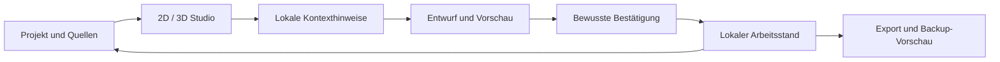
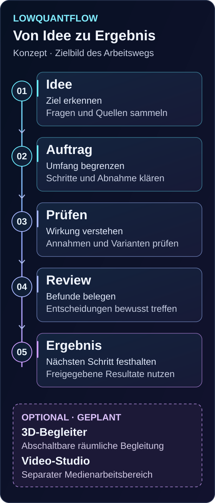
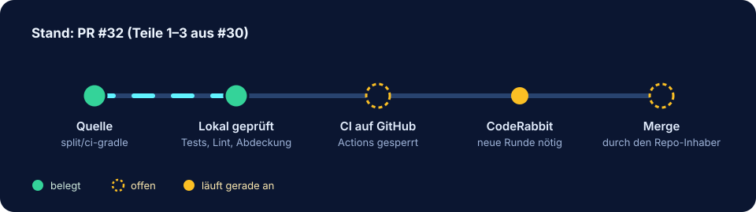
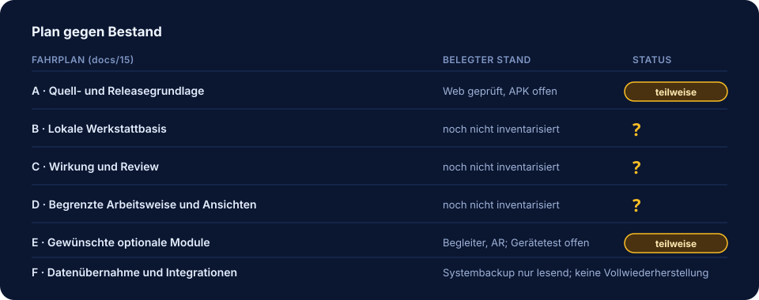

# LowQuantFlow
### Deine lokale Werkstatt für Projekte, Wissen und nächste Schritte




[Statische Ansicht](docs/assets/lowquantflow-hero-static.svg) · [Appquelle](app/) · [Aktueller Entwicklungsnachweis](docs/29-k3-quality-adoption.md) · [Nachprüfung 2026-11-03](docs/30-verifikation-2026-11-03.md) · [OMEGA-Plan](docs/31-analyse-und-omega-plan.md) · [Dokumentation](docs/README.md) · [Anforderungsabdeckung](docs/16-acceptance-matrix.md) · [Arbeitslos K1](docs/25-context-continuation-work-package.md)

Die Grafik ist ein eigenes Designkonzept, kein App-Screenshot und kein Leistungsnachweis.

LowQuantFlow verbindet **17 Arbeitsbereiche**, ein visuelles **2D-/3D-Studio**, lokale **Skills und Prüfprozesse**, einen optionalen **3D-Begleiter** und kontextbezogene **Assistenz** in einer Android-first-App. Projekte, Quellen und Entscheidungen bleiben nachvollziehbar; Änderungen werden bewusst geprüft und bestätigt.

> **Laufende 0.5.4-Entwicklung, keine neue Ausgabe.** Assistant-Host, Mobile-Multitouch, lesende K1-Fortsetzung, gezieltes K2-Entwurfsöffnen mit Änderungsvorschau sowie K3-Ergebnisnavigation und Tab-/History-Routing sind im unabhängig geprüften Webgesamtstand enthalten. Die Beratung bleibt eine Offline-Simulation; es ist keine echte LLM-Engine verbunden. Keine Versionsanhebung, kein Nutzerpaket oder APK-Release. Native-/Gerätegates bleiben offen.

## Was in der App steckt

| Bereich | Vorhandener Umfang | Quelle und Grenzen |
| --- | --- | --- |
| **2D · Überblick** | Graph-Perspektiven, Beziehungen, Filter und kombinierte Arbeitsflächen | [Studio und Bedienung](app/README.md#was-du-direkt-tun-kannst) |
| **3D · Raum** | Räumliche Graphansicht, Auswahlshader und Hologramm-Bildschirmstil; zugängliche 2D-Alternativen | [Level-/AR-Module](app/extensions/level-ar/) |
| **AR · bewusst starten** | Browser-WebXR und optionaler experimenteller nativer ARCore-Adapter | [Native AR](app/docs/NATIVE-AR-INTEGRATION.md); reale Kamera-/Geräteabnahme offen |
| **Begleiter · Präsenz** | Lokales 3D-Modell mit Walk, Idle, Think, Celebrate, Idea und Caution; Text-/SVG-Ausweichansichten | [Begleiter, Attribution und Grenzen](app/src/companion/README.md) |
| **Assistenz · Kontext** | Lokale Kontexthinweise, Graphhilfe, Projektgedächtnis und persönliche Entwürfe | [Kontextassistenz](app/docs/context-assistance.md) · [Projektgedächtnis](app/docs/PROJECT-MEMORY.md) |
| **Mobile · Android-first** | Native Dateidialoge, mobile Steuerung, getrennte Android-Identität | [Mobile Bedienung](app/docs/mobile-controls.md) · [Dateien](app/docs/NATIVE-FILES.md) |

### Bewegung und Effekte

Der Begleiter verwendet einen begrenzten, sichtbarkeitsgesteuerten Animationsloop. Reduced Motion, Energiesparen und Pause werden berücksichtigt; bei fehlender Grafikfähigkeit bleiben Text-/SVG-Wege verfügbar. Seine Statusdarstellung führt selbst keine Aufträge aus.

Die animierte README-Grafik zeigt die gestalterische Richtung. Der aktuelle Stand enthält das kompakte App-Menü, begrenzte Assistentenübergänge, native AR-Status-/Detailkorrekturen und räumliche AR-Knotendarstellung. Ein lokaler Qualitätsvertrag prüft den bewusst angenommenen Quell- und Teststand. Animationen und Softwaretests belegen keine GPU-, Akku- oder Geräteperformance.

## Vom Überblick zur bewussten Aktion



[](docs/assets/workshop-flow.svg)

Das Diagramm beschreibt den lokalen Arbeitsablauf. Externe Agentenausführung, Cloud-Synchronisation und produktive Vollwiederherstellung sind damit nicht zugesagt.

## Individuelle Darstellung in 0.5.4

- Drei Farbkanäle, Form und Größe für die unterstützten Knoten-/Raumdarstellungen bearbeiten
- Änderungen zunächst als Vorschau sehen; Abbrechen stellt den vorherigen Zustand wieder her
- Gespeicherte individuelle Raumdarstellung bleibt dem gewählten Raum zugeordnet
- Rotation und projizierte Beschriftungen bleiben beim Bearbeiten stabil; Labelsichtbarkeit folgt der tatsächlichen Szene
- Späte WebGL-/XR-Fehler behalten einen terminalen Fehlerzustand und vorhandene XR-Abschlussverantwortung
- Assistentenvorschauen schützen auch den geprüften asynchronen Race-Fall

Individuelle Darstellungen werden lokal getrennt gespeichert und sind **nicht im bisherigen Projektbackup enthalten**. Eine Reset-Vorschau ist noch kein gespeicherter Reset. [Darstellungsquelle](app/src/appearance/) · [Web-Releasehinweise](docs/24-appearance-054-web.md)

## Beratung nachvollziehbar, Bedienung sicher unterbrochen

- Unbestätigte Vorschläge und externe Aussagen sind getrennt von der bestätigten Hostgrundlage sichtbar
- Herkunft und Quellen werden ausgewiesen; fehlende Quellen bleiben ausdrücklich erkennbar
- Die vorhandene projektbezogene Kompakt-/Detail-Einstellung steuert die Quelldetails
- Abbruch, Projektwechsel, überholte Anfragen und inzwischen veraltete Arbeitsstände lassen keine alte Beratung als aktuell stehen
- Offene Adapteraufrufe und lokal verworfene Ergebnisse bleiben getrennte Zustände; ein Abbruch behauptet kein bestätigtes Ende einer fremden Engine
- Die mobile Aktionsleiste bleibt während einer gehaltenen Eingabe und mehrerer beteiligter Zeiger aus dem Weg; sie kehrt erst nach deren Ende zurück

Der produktive Adapter ist weiterhin der Simulator. Vorschlagstext erhält keine Schreibrechte und ersetzt keine Bestätigung. [Hostgrenzen und Testumfang](app/docs/assistant-advisory-host.md) · [Geprüfter Entwicklungsnachtrag](docs/25-assistant-host-mobile.md)

## K1: bewusst beim richtigen Projekt fortsetzen

Die Fortsetzungskarte zeigt einen bestätigten nächsten Schritt und die tatsächlich gespeicherten Entwurfsmetadaten des gewählten Projekts: Status, Revision, Art und Speicherzeit. Veraltete Grundlagen sowie aktive, übernommene, verworfene und fehlende Entwürfe bleiben unterscheidbar. Entwurfstext und ungesicherte Eingaben gehen nicht in die Beratung ein.

„Projekt fortsetzen“ prüft die Grundlage erneut und navigiert bewusst zum bestehenden Projektgedächtnis derselben Projektinkarnation. Es öffnet oder übernimmt keinen Entwurf automatisch, bestätigt keinen Inhalt und startet keinen Workflow. Der vorhandene Editor behält seine eigene Autosicherung und Konfliktbehandlung.

[K1-Nachweis und Grenzen](docs/26-k1-continuation.md) · [Implementierte Verträge](app/docs/assistant-continuation-k1.md)

## K2: gewählte Revision öffnen, Änderung prüfen, bewusst übernehmen

K2 öffnet die ausdrücklich gewählte gespeicherte Entwurfsrevision im bestehenden Editor. Projektinkarnation, Revision und Navigation werden geprüft. Historywechsel entwerten alte Wechselentscheidungen auch bei Rückkehr zur gleichen URL; eine kontrollierte interne Rückkehr nach gescheiterter Sicherung erhält dagegen die noch offene Entscheidung.

„Änderung prüfen“ sichert den persönlichen Entwurf über die vorhandene Sicherung und liest ihn erneut. Die Vorschau zeigt Projekt, Revision, Grundlage, Art, Herkunft und den konkreten Text; bei einer Korrektur zusätzlich den bisherigen Eintrag. Erst „Geprüften Vorschlag übernehmen“ erzeugt aus exakt dieser Fassung einen unbestätigten Vorschlag. Die separate Bestätigung bleibt erforderlich.

Neue Eingaben, Laden, Öffnen, Rebase, Verwerfen, Projekt-/Tab-/Historywechsel entwerten die Vorschau. Fremde Änderungen werden durch die bestehenden atomaren Revisions-/Basisprüfungen abgewehrt; Abbrechen erhält den Entwurf. Eine verlorene Schreibantwort löst kein automatisches zweites Schreiben aus. Dies ist Nutzersichtprüfung mit lokalen Vertragsprüfungen, keine fachliche Modellprüfung oder autonome Ausführung.

[Produktkontext und geprüfte Grenzen](docs/27-product-continuation-context.md) · [K1/K2-Verlauf](docs/25-context-continuation-work-package.md)

## K3: übernommenen Vorschlag wiederfinden und bestätigt fortsetzen

Nach einer bewussten Übernahme lässt sich der genaue gespeicherte Vorschlag in der vorhandenen Memoryansicht wiederfinden, auch wenn Such-/Historienfilter ihn verdeckt haben. Der Sprung liest den Stand erneut, prüft Identität, Revisionen und Route, setzt passende Filter zurück und fokussiert die bestehende Eintragskarte. Er bestätigt nichts automatisch und errät keine Identität aus gleichem Text.

Bestätigen, Korrigieren, Vergessen und Wiederherstellen prüfen synchron die aktuelle Ansicht, Schreibfähigkeit, Eintrags-/Memoryrevision und Navigationsgeneration. Alte Callbacks bleiben nach Navigation ungültig; neu gerenderte Aktionen nach Rückkehr bleiben nutzbar.

Der reguläre Memory→Assistant→Reload-Weg verwendet eine gültige Assistenten-URL ohne Memoryparameter. Die validierte Memory-Inkarnation bleibt im passenden Browser-History-Eintrag und wird nur beim bewussten Memory-Tabwechsel wiederhergestellt. Entwurfsdaten und Freigaben werden nicht in History abgelegt. Vorhandene Autosave-/Flush-/Cancel-Grenzen bleiben erhalten.

[K3-Flow und Routing](docs/28-memory-result-continuation.md) · [Angenommener gemeinsamer Nachweis](docs/29-k3-quality-adoption.md)

## Belegter Web-Prüfstand

**Quality-Scope: 1.025 Dateien**, unverändert aus dem unabhängig angenommenen Gesamtstand. Im vollständigen app/-Baum bleiben zusätzlich zwei historische, vom Quality-Scope ausgeschlossene Dokumentationsmanifeste erhalten: **1.027 Dateien**.

- 1.492 Node-Laufzeittests und 50 Qualitytests bestanden
- Alle fünf Gatephasen PASS: preflight, qualityTests, verifySerial, postflight, sourceStability
- TypeScript, Generatoren, Rendererprüfung und Webbuild erfolgreich; keine Quelldrift
- 61 Webassets mit Inhaltshash `94d581a5f55d3ebf827ecf8296363c84fa2dcf3197d0d6dd2674a50c01fd92eb`
- Gebundene Desktop-/Mobilbrowsernachweise zu K3-Ergebnisnavigation, Eintragsaktionen und echtem Tab-/Reload-/History-Routing und erhaltene Assistant-/Mobile-Regressionsbelege; genaue Grenzen im Entwicklungsnachtrag
- Native Android-/APK-/physische Geräteabnahme: weiterhin offen

Quality-Source-SHA-256: `96464ab1bf3e43e2c9fd3f611605d54e104062447262858ccb4df3113366ed03`

[Sourceinventar](docs/reference/k3-routing/source-adopted.json) · [Prüfzusammenfassung](docs/reference/k3-routing/verification-summary.json) · [Adoptionsnachweis](docs/reference/k3-routing/adoption.json) · [Vollständiges Prüflog](docs/reference/k3-routing/verify-quality.log)

Die Browserbelege stammen vom identischen Appcode vor der abschließenden reinen Qualitymetadaten-Adoption. Alle 61 Buildassets sind identisch. Vorhandene ReadPixels-/GPU-Stall-Warnungen bleiben sichtbar; daraus wird keine Hardware-, FPS- oder Akkuleistung abgeleitet. Die frühere Appearance-/Room-Prüfung bleibt mit ihrem ursprünglichen Befund und erfolgreichem Wiederholungslauf als Historie dokumentiert. Der aktuelle K3-/Routing-Build ist identisch zur unabhängig geprüften Browserfassung; kein erneuter Browserlauf durch die reine Qualityadoption oder Veröffentlichung behauptet.

## Lokal prüfen und starten

Voraussetzungen: Node.js 22.18+ innerhalb 22 LTS oder 24 LTS und npm.

```sh
cd app
npm ci
npm run verify:quality -- --contract-sha256 e044726fd302fba23b5007eb036be3642348fffc19d4583d719daea218bc4d5d
npm run preview
```

Der Pin wurde außerhalb des Kandidaten unabhängig angenommen. Baseline und Vertrag wurden bewusst geprüft; keine automatische Selbstadoption, keine Ausnahmen und keine abgeschwächten Tests. Ein vertrauenswürdiger Host muss den akzeptierten Prüfer und Pin verwenden. Das lokale Gate ersetzt keinen verpflichtenden GitHub-Branchschutz.

Die Vorschau läuft nach Standardkonfiguration auf http://127.0.0.1:4173. Der Quality-Scope und seine festen Ausnahmen sind in [quality/README.md](app/quality/README.md) beschrieben. Ältere eingebettete Buildmanifeste bleiben historische Herkunftsdateien; aktuelle APP-Provenienz bestimmen Git-Commit und das neue Sourceinventar.

## Android und Daten

Installations-ID: `de.lowgiga.cuecommandmesh.next`. Der Java-Namespace bleibt `de.lowgiga.cuecommandmesh.preview`. Die vorherige Preview-Installation und ihre privaten Daten werden nicht automatisch übernommen.

Für 0.5.4 liegt hier **keine native oder APK-Freigabe** vor. Voraussetzungen und Signiergrenzen stehen in [app/README.md](app/README.md#android-bauen) und [Signing & Recovery](app/docs/SIGNING-AND-RECOVERY.md). Private Schlüssel, APKs und lokale SDK-Konfiguration werden nicht ins Repository aufgenommen.

- Exporte bleiben nötig; Deinstallation oder Speicherräumung kann lokale Daten löschen
- Systembackup-Import bleibt eine lesende Vorschau, keine produktive Vollwiederherstellung
- Persönliche Entwürfe, Darstellungsoptionen und Workflow-Wiederaufnahme haben unterschiedliche Speicher-/Exportgrenzen
- Hologramm ist ein Bildschirmstil; 3D und Kamera-AR haben unterschiedliche Voraussetzungen
- Keine neue physische S25-/Touch-/Kamera-/Tracking-/GPU-, Bildraten- oder Akkuabnahme behauptet

## Stand dieses Branches (4. November 2026)

<p align="center"></p>

| Punkt | Stand | Beleg |
| --- | --- | --- |
| Entwicklungsbranch `split/ci-gradle` → [PR #32](https://github.com/Lowgiga/APP/pull/32) | Teile 1–3 der Aufteilung von #30 (CI, Prüfwerkzeuge, Doku); CodeRabbit-Runde für die letzten beiden Commits angefordert, Ergebnis ausstehend | Commit `a124464` |
| [PR #31](https://github.com/Lowgiga/APP/pull/31) (N2, Laufjournal) | Entwurf, nicht gemergt | [Upload-Prüfung](docs/36-uploads-2026-11-04.md) |
| [PR #34](https://github.com/Lowgiga/APP/pull/34) (OMEGA) | eingefroren, nicht mergen | [OMEGA-Plan](docs/31-analyse-und-omega-plan.md) |
| `main` | Stand `531e4ec` mit den Merges von #8 und #9 | Git-Historie |

Die Web-Gesamtverifikation mit 1.542 Tests und die 71 JVM-Tests stammen vom 3. November und sind im [Nachweis](docs/30-verifikation-2026-11-03.md) belegt. Sie wurden für diesen Branch nicht erneut ausgeführt.

### Prüfwerkzeuge im Repository

<p align="center"></p>

| Werkzeug | Zweck | Tests |
| --- | --- | --- |
| [`tools/ci/check_markdown_links.py`](tools/ci/check_markdown_links.py) | Prüft relative Links, Bilder und Referenzdefinitionen über einen CommonMark-Parser (markdown-it-py, hash-gepinnt) | 48 (ganzes `tools/ci`) |
| [`tools/ci/build_fingerprint.py`](tools/ci/build_fingerprint.py) | Fingerabdruck des Webbuilds, vergleichbar zwischen Node-Versionen | in den 48 enthalten |
| [`tools/ci/check_asset_hashes.py`](tools/ci/check_asset_hashes.py) | Prüft die SHA-256-Liste in [`docs/assets/README.md`](docs/assets/README.md) gegen die SVG-Dateien | 4 |
| [`tools/ci/check_test_counts.py`](tools/ci/check_test_counts.py) | Prüft Badge und Tabelle dieser README gegen die tatsächlich gefundenen Tests | 8 |
| [`tools/repo/pr_triage.py`](tools/repo/pr_triage.py) | Deterministische PR-Triage gegen Git-Objekte und einen PR-Export | 17 |
| [`tools/repo/requirements_inventory.py`](tools/repo/requirements_inventory.py) | Erzeugt die Bestandsaufnahme ([Doku 37](docs/37-bestandsaufnahme.md)) aus der Anforderungsmatrix und prüft sie in der CI (`--check`) | 16 |
| [`tools/windows/omega_host_audit.py`](tools/windows/omega_host_audit.py) | Nur lesendes Prüfen eines Windows-Hosts gegen die Regeln aus [Doku 33](docs/33-hermes-sicher-einrichten.md) | 44 |
| [`tools/check-toolchain.sh`](tools/check-toolchain.sh) | Prüft Node, JDK 21 (Compiler und Laufzeit) und das Android SDK | über die CI-Tests |

Die Abdeckung der Python-Werkzeuge liegt lokal bei 100 % Zeilen und Verzweigungen. Die CI verlangt mindestens 98 % ([`tools/ci/coverage.ini`](tools/ci/coverage.ini)). Die Abhängigkeiten sind hash-gepinnt ([`tools/ci/requirements.txt`](tools/ci/requirements.txt), [`tools/ci/requirements-lint.txt`](tools/ci/requirements-lint.txt)).

In der CI ([`.github/workflows/ci.yml`](.github/workflows/ci.yml)) laufen die Jobs Web (Node 22.18 und 24), Reproduzierbarkeit, Android, Doku (Links, Konsistenzprüfungen, Tests) sowie Lint. **Ihr Lauf auf GitHub ist nicht nachgewiesen**: In diesem Repository startet kein Workflow (`startup_failure`, Einstellung auf Repo- oder Kontoebene). Lokal mit denselben Befehlen und gepinnten Versionen ausgeführt wurden nur die Jobs Doku und Lint, Lint ohne actionlint. Der Android-Job und actionlint liefen lokal nicht in CI-Form. Der Webbuild lief am 3. November unter Node 22.23.4 und 24.22.1, nicht unter dem CI-Minimum 22.18.0 (Einzelheiten in [Doku 30](docs/30-verifikation-2026-11-03.md)). Geräteprüfungen sind kein CI-Job und nicht nachgewiesen.

Für Änderungen gelten die Regeln in [CLAUDE.md](CLAUDE.md). Die Prüfung vor jedem Abschluss beschreibt der Projekt-Skill [`reviewing-changes-strictly`](.claude/skills/reviewing-changes-strictly/SKILL.md).

<details>
<summary><strong>Prüfkette im Detail</strong> (klappen)</summary>

Lokal ausgeführt wurden diese Prüfungen, mit denselben Befehlen und gepinnten Versionen wie die CI. Android, Web unter Node 22.18.0 und actionlint liefen lokal nicht; Geräteprüfungen sind nicht nachgewiesen:

1. `python -m ruff check tools/` und `python -m ruff format --check tools/` (ruff 0.17.3). Der Aufruf über `python -m` ist Absicht: Ein anderes `ruff` im `PATH` kann die gepinnte Version verdecken, das ist hier passiert.
2. `shellcheck -x tools/*.sh`
3. `coverage run` für `tools/ci`, `tools/repo` und `tools/windows`, danach `coverage report` mit `COVERAGE_RCFILE=tools/ci/coverage.ini`
4. `python tools/ci/check_markdown_links.py .` (CommonMark-Parser, hash-gepinnt)
5. Konsistenz: `python tools/repo/requirements_inventory.py --check docs/37-bestandsaufnahme.md`, `python tools/ci/check_test_counts.py .` und `python tools/ci/check_asset_hashes.py docs/assets`
6. Gegenprobe: Jeder neue Regressionstest muss gegen den vorherigen Commit fehlschlagen

Die Regel dafür steht im Projekt-Skill [`reviewing-changes-strictly`](.claude/skills/reviewing-changes-strictly/SKILL.md).

</details>

<details>
<summary><strong>Befunde der Reviews und Folgefehler</strong> (klappen)</summary>

- Mehrere CodeRabbit-Runden, jeder Befund mit Regressionstest. Die Ursachen stehen im [Changelog](CHANGELOG.md) und in den Antworten im PR; die Zählung je Runde ist dort nicht vollständig belegt.
- Eigene Befunde aus der Tiefenprüfung wurden ergänzt, z. B. Groß-/Kleinschreibung bei Links, Links aus dem Repo heraus und unlesbare Konfigurationsdateien.
- Die Befunde der Runde zu `a124464` sind in `8aa43e5` behoben. Die Runde zu `cd98769` ergab 3 Befunde (Host-Audit unter Windows, Lint-Befehle in `AGENTS.md`, zu weite Aussage zur lokalen Prüfung). Alle drei sind behoben, siehe [Changelog](CHANGELOG.md). Die eigene Tiefenprüfung derselben Runde fand 13 weitere Befunde in den neuen Werkzeugen, die CodeRabbit als unauffällig bewertet hatte.

</details>

### Nicht nachgewiesen

- **Windows-Lauf des Host-Audits:** Das Skript lief noch nie auf echtem Windows. Offen ist vor allem der UTF-8-Präfix für PowerShell.
- **GitHub Actions:** siehe oben.
- **actionlint lokal:** Das Ausführen des heruntergeladenen Programms war in der Entwicklungsumgebung nicht erlaubt. Der CI-Schritt prüft das Archiv gegen die offizielle Prüfsumme; ausgeführt wurde er nicht.
- **Dependabot:** Die 105 Warnungen aus der früheren Analyse konnten mit dem vorhandenen Token nicht abgerufen werden (HTTP 403). Der Stand ist unverifiziert.
- **Android, Gerät, Kamera-AR, Akku, Bildrate:** wie im Abschnitt zu Android und Daten oben.

## Zukunftspläne und offene Entscheidungen

<p align="center"></p>

Diese Punkte sind **nicht umgesetzt** und werden vor dem nächsten Schritt besprochen:

1. **OMEGA ([PR #34](https://github.com/Lowgiga/APP/pull/34)):** eingefroren, bis das Ziel festgelegt ist. Offen ist, ob der Entwurf in Python neu aufgebaut oder geschlossen wird.
2. **Native Gates ([Paket A](docs/15-roadmap.md#paket-a--quell--und-releasegrundlage)):** vollständiges JDK 21 und Gradle-Auflösung, danach Tests, Lint, APK, Signierung und Geräteprüfung.
3. **Dependabot:** Analyse der Warnungen, sobald der Zugriff vorhanden ist. Änderungen an gesperrten Lockfiles brauchen eine Quality-Adoption.
4. **Windows-Lauf des Host-Audits** auf einem echten Rechner, mit einer Firewall-Regel, deren Name `ü` enthält.
5. **Merge von #32** nach der CodeRabbit-Prüfung der letzten beiden Commits.
6. **Sicherheitsvorkehrungen:** Branchschutz und die Freischaltung von GitHub Actions liegen beim Repository-Inhaber, nicht im Code.
7. **Bestandsaufnahme Plan gegen Ist:** erledigt in [Doku 37](docs/37-bestandsaufnahme.md). Die Tabelle wird aus [Doku 16](docs/16-acceptance-matrix.md) erzeugt und in der CI auf Abweichung geprüft.

## Quelle, Nachweise und Historie

- **app/**: vollständiger Entwicklungsquellstand mit Tests und bewusst angenommenen Qualitymetadaten
- **docs/29-k3-quality-adoption.md**: aktueller gemeinsamer Qualitätsnachweis
- **docs/28-memory-result-continuation.md**: K3-Ergebnisnavigation und Routing
- **docs/27-product-continuation-context.md**: erhaltener Produktkontext und offene Grenzen
- **docs/26-k1-continuation.md**: unverändert erhaltener K1-Nachweis
- **docs/25-assistant-host-mobile.md**: vorheriger Assistant-/Mobile-Nachtrag
- **docs/24-appearance-054-web.md**: vorheriger Appearance-Webstand
- **docs/reference/k3-routing/**: aktuelle K3-/Routing-Prüfbelege
- **docs/reference/k2-preview/**: erhaltene K2-/Vorschau-Prüfbelege
- **docs/reference/k1-continuation/**: unverändert erhaltene K1-Prüfbelege
- **docs/reference/assistant-host-mobile/**: erhaltene Assistant-/Mobile-Prüfbelege
- **docs/reference/appearance-054/**: erhaltene Belege des vorherigen Appearance-Stands
- **docs/23-source-final984.md** und **docs/reference/final984/**: vorheriger 0.5.3-Stand
- **docs/22-source-freeze-949.md** und **docs/reference/freeze-949/**: früherer Integrationsschritt
- **docs/assets/**: eigene Konzeptgrafiken mit statischen Alternativen

[Produkt](docs/01-product.md) · [Architektur](docs/02-current-architecture.md) · [Datenmodell](docs/04-data-model.md) · [Skills](docs/08-skills-workflows.md) · [Sicherheit](SECURITY.md) · [Designkonzept](docs/21-readme-design.md)

Dieser Entwicklungsbranch ist ein gestapelter Reviewstand. main und der separate FINAL984-Branch werden durch diese Veröffentlichung nicht zusammengeführt oder überschrieben.
