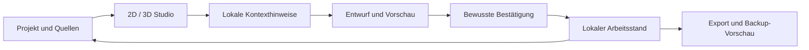

# LowQuantFlow
### Deine lokale Werkstatt für Projekte, Wissen und nächste Schritte


[Statische Ansicht](docs/assets/lowquantflow-hero-static.svg) · [Appquelle](app/) · [Prüfstand FINAL984](docs/23-source-final984.md) · [Dokumentation](docs/README.md)

Die Grafik ist ein eigenes Designkonzept, kein App-Screenshot und kein Leistungsnachweis.

LowQuantFlow verbindet **17 Arbeitsbereiche**, ein visuelles **2D-/3D-Studio**, lokale **Skills und Prüfprozesse**, einen optionalen **3D-Begleiter** und kontextbezogene **Assistenz** in einer Android-first-App. Projekte, Quellen und Entscheidungen bleiben nachvollziehbar; Änderungen werden bewusst geprüft und bestätigt.

> **Aktueller Quellstand: Prototyp 0.5.3 · FINAL984 · Versionscode 11.** Die 984 Appdateien entsprechen der geprüften Quellgrundlage der separat gelieferten debug-signierten Test-APK. Die APK und Signierschlüssel liegen nicht in diesem Repository. Reale S25-/Touch-/Kamera-/GPU-Abnahmen bleiben offen.

## Was in der App steckt

| Bereich | Vorhandener Umfang | Quelle und Grenzen |
| --- | --- | --- |
| **2D · Überblick** | Graph-Perspektiven, Beziehungen, Filter und kombinierte Arbeitsflächen | [Studio und Bedienung](app/README.md#was-du-direkt-tun-kannst) |
| **3D · Raum** | Räumliche Graphansicht, Auswahlshader und Hologramm-Bildschirmstil; zugängliche 2D-Alternativen | [Level-/AR-Module](app/extensions/level-ar/) |
| **AR · bewusst starten** | Browser-WebXR und optionaler experimenteller nativer ARCore-Adapter | [Native AR](app/docs/NATIVE-AR-INTEGRATION.md); reale Kamera-/Geräteabnahme offen |
| **Begleiter · Präsenz** | Lokales 3D-Modell mit Walk, Idle, Think, Celebrate, Idea und Caution; Text-/SVG-Ausweichansichten | [Begleiter, Attribution und Grenzen](app/src/companion/README.md) |
| **Assistenz · Kontext** | Lokale Kontexthinweise, Graphhilfe, Projektgedächtnis und persönliche Entwürfe | [Kontextassistenz](app/docs/context-assistance.md) · [Projektgedächtnis](app/docs/PROJECT-MEMORY.md) |
| **Mobile · Android-first** | Native Dateidialoge, mobile Steuerung, getrennte Android-Identität | [Mobile Bedienung](app/docs/mobile-controls.md) · [Dateien](app/docs/NATIVE-FILES.md) |

### Bewegung und Effekte

Der Begleiter verwendet einen begrenzten, sichtbarkeitsgesteuerten Animationsloop. Reduced Motion, Energiesparen und Pause werden berücksichtigt; bei fehlender Grafikfähigkeit bleiben Text-/SVG-Wege verfügbar. Seine Statusdarstellung führt selbst keine Aufträge aus.

Die animierte README-Grafik zeigt die gestalterische Richtung. FINAL984 enthält zusätzlich das kompakte App-Menü, begrenzte Assistentenübergänge, native AR-Status-/Detailkorrekturen und räumliche AR-Knotendarstellung. Ein lokaler Qualitätsvertrag prüft den bewusst angenommenen Quell- und Teststand. Animationen und Softwaretests belegen keine GPU-, Akku- oder Geräteperformance.

## Vom Überblick zur bewussten Aktion



[](docs/assets/workshop-flow.svg)

Das Diagramm beschreibt den lokalen Arbeitsablauf. Externe Agentenausführung, Cloud-Synchronisation und produktive Vollwiederherstellung sind damit nicht zugesagt.

## Nachweisbarer Quellstand

**FINAL984 · Prototyp 0.5.3 · 5. Oktober 2026**

- **984 Dateien**, **13.296.294 Bytes**, unverändert unter [app/](app/)
- **1.324 Host-Testfälle bestanden**: 50 Qualitätsgate-Fixtures und 1.274 Produkt-/Integrationstests; 0 Fehler, 0 übersprungene Tests
- Zusätzlich **18 Renderer-Szenarien**, TypeScript-, Herkunfts-, Generator- und Webbuildprüfungen bestanden
- Separater echter Offline-Gradle-Lauf: **62 native Unit-Tests** bestanden; AR-Lint ohne Befund
- Webbuild: **57 Dateien** mit separatem SHA-256-Inventar
- Browser-Pixel-, S25-/Touch-/Kamera-/GPU-, Bildraten- und Akkuabnahme: **offen**

[Prüfbeleg](docs/reference/final984/FINAL-Pruefbeleg.json) · [Quellhashes](docs/reference/final984/FINAL-files.sha256) · [Quellmanifest](docs/reference/final984/FINAL-Quellmanifest.json) · [Webbuild-Hashes](docs/reference/final984/FINAL-build-files.sha256) · [Release Notes mit APK-Nachtrag](docs/reference/final984/FINAL-Release-Notes.md)

Quellbaum-SHA-256: `8be6face68bfa3307c92deb86d386850215c7d41e2fe781ac2206278a54dd7ea`

Git-Tree von `app/`: `f8080983412f4b2ca3693112dbfef8f954ee352c`. Alle 984 Remote-Blob-SHAs und Dateimodi wurden mit dem lokalen Freeze abgeglichen.

Die separat ausgelieferte APK ist debug-signiert und bleibt ein Testprototyp. Ihr App-Lint enthält 13 dokumentierte Warnungen. Softwareprüfung und erfolgreiche APK-Erstellung sind keine Produktions- oder Gerätefreigabe.

Der frühere [Quellfreeze 949](docs/22-source-freeze-949.md) bleibt mit seinen Nachweisen und seinem Git-Commit erhalten. Der nachvollziehbare Übergang umfasst **35 neue und 33 geänderte Dateien**, ohne Quelldateien zu löschen. Ältere Berichte innerhalb der Originalquelle behalten ihren historischen Status; maßgeblich ist [der aktuelle Nachweis](docs/23-source-final984.md).

## Lokal starten

Voraussetzungen: Node.js **22.18+ innerhalb 22 LTS oder 24 LTS** und npm.

```sh
cd app
npm ci
npm run verify:quality -- --contract-sha256 09e370e0db63c6b420adcac7ac5594b8d4721ced73d46a65759d5b0a22ca56a3
npm run preview
```

Die Vorschau läuft auf http://127.0.0.1:4173. Der Qualitätslauf prüft Vertrag, bewusst angenommene Baseline, Quellen, vorhandene Tests und einen frischen Webbuild. Der lokale Vertrag ersetzt weder einen vertrauenswürdigen externen Prüfer noch verpflichtende GitHub-CI oder Branchschutz. DOM-/Renderer-Simulationen ersetzen keine reale Browser- oder Geräteprüfung.

### Den veröffentlichten Quellstand prüfen

Vor einem Build, der generierte Dateien aktualisieren kann:

```sh
cd app
sha256sum -c ../docs/reference/final984/FINAL-files.sha256
sha256sum ../docs/reference/final984/FINAL-files.sha256
```

Der zweite Befehl muss den oben genannten Quellbaum-Hash liefern. Die Dateiliste bezieht sich auf den Inhalt von `app/`, nicht auf die zusätzliche Repository-Dokumentation.

### Android

Die App verwendet die separate Installations-ID `de.lowgiga.cuecommandmesh.next`. Die vorhandene Preview-Installation und ihre privaten Daten werden dadurch nicht automatisch übernommen.

Buildvoraussetzungen, Capacitor-Sync, Webasset-Abgleich und kontrollierte Signierung stehen in [app/README.md](app/README.md#android-bauen) und [Signing & Recovery](app/docs/SIGNING-AND-RECOVERY.md). Die separat gelieferte Test-APK wurde aus diesem geprüften Quell-/Webstand gebaut; das Verhalten auf echter Hardware bleibt gesondert zu prüfen. Ältere Statusformulierungen in der unverändert erhaltenen App-Originaldokumentation sind historische Angaben. Zugangsdaten, Signierschlüssel und lokale SDK-Pfade gehören nicht ins Repository.

## Orientierung

- **app/**: vollständiger Quellfreeze mit Tests, Android-Hülle, gebündelten Modulen, Originalquellen und Herkunftsnachweisen
- **docs/reference/final984/**: aktuelle Inventare, Release Notes und Prüfbelege; **freeze-949/** erhält den vorherigen Nachweis
- **docs/23-source-final984.md**: aktueller Stand; **docs/22-source-freeze-949.md** dokumentiert den historischen Zwischenschritt
- **docs/01–21 und ältere Referenzen**: erhaltene Produkt-, Architektur- und Entwicklungsdokumentation mit ihrem jeweiligen historischen Datum
- **docs/assets/**: eigene Konzeptgrafiken und statische Alternativen

[Produkt](docs/01-product.md) · [Architektur](docs/02-current-architecture.md) · [Datenmodell](docs/04-data-model.md) · [Skills](docs/08-skills-workflows.md) · [Sicherheit](SECURITY.md) · [Designkonzept](docs/21-readme-design.md)

## Bewusste Grenzen

- Lokale Arbeitsdaten benötigen eigene Exporte; Deinstallation oder Speicherräumung kann sie löschen
- Systembackup-Import ist eine **lesende Vorschau**, keine produktive Vollwiederherstellung
- Hologramm ist ein Bildschirmstil; 3D und Kamera-AR haben unterschiedliche Voraussetzungen
- Kamera und AR-Dienste starten nur über den dafür vorgesehenen bewussten Einstieg
- Lokale Assistenz bestätigt keine externen Agenten, Fremdidentitäten oder Cloudzugriffe
- Native Lifecycle-, Datei-, GPU-, Kamera- und Akkuprüfungen bleiben gesonderte Abnahmen
