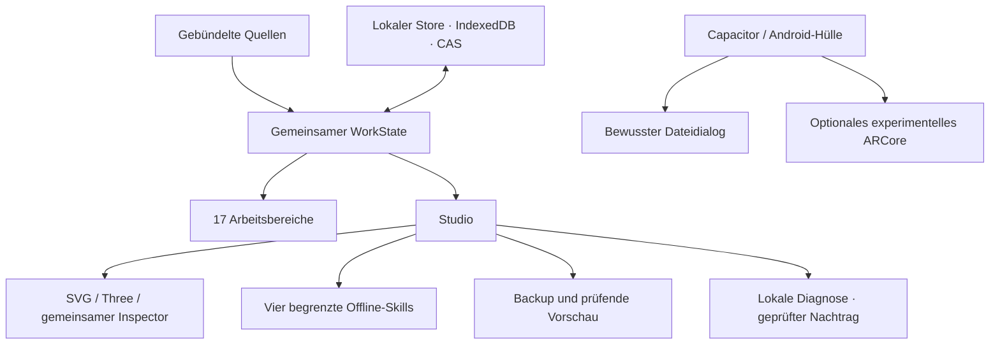

# LowQuantFlow

**Die persönliche Entwicklungswerkstatt: Ideen formen. Wirkung verstehen. Ergebnisse belegen.**

Eigene animierte Konzeptgrafik, kein App-Screenshot. [Statische Ansicht](docs/assets/lowquantflow-hero-static.svg) · [Grafiknachweise](docs/assets/README.md)

> **Dieses private Repository „APP“ enthält derzeit Dokumentation und eigene Grafiken.** App-Source, package.json, Source-ZIP, Signierschlüssel und APK sind hier nicht hinterlegt. Ein Repositoryklon ist deshalb noch kein baubares App-Projekt.

## Direkt einsteigen

| Verstehen | Entwickeln | Prüfen |
| --- | --- | --- |
| [Produkt und Arbeitsweise](docs/01-product.md) | [Iststruktur und Modulrollen](docs/03-source-tree.md) | [Status und offene Grenzen](docs/17-status-evidence.md) |
| [17 Bereiche und Studio](docs/06-ui-navigation.md) | [Datenmodell und Flüsse](docs/04-data-model.md) | [27 Anforderungen, sieben Gates](docs/16-acceptance-matrix.md) |
| [2D · 3D · AR · Lernen](docs/07-visualization-learning.md) | [Power-User-Methodik](docs/20-power-user-method.md) | [Tests, Build und Signierung](docs/12-build-signing-release.md) |

[Gesamte Dokumentation](docs/README.md) · [Arbeitspakete](docs/15-roadmap.md) · [Beiträge](CONTRIBUTING.md)

## Der belegte Stand

**4. Oktober 2026 · Quellkandidat 0.5.2-v7-workflow-recovery-reconstructed**

| Nachweis | Stand |
| --- | --- |
| Installierbarer vorhandener Stand | Original 0.5.0 |
| Finale Quality-/Diagnose-/Brandingkombination | **264 gezielte Tests in 24 Dateien**, Typecheck **0 Diagnosen**, unabhängig geprüft |
| Exaktes finales Quellinventar | **859 Dateien**, vollständige [Pfade und SHA-256](docs/reference/source-inventory.md) |
| Sichtbare Marke / neue technische Identität | LowQuantFlow / de.lowgiga.cuecommandmesh.next |
| Neue LowQuantFlow-/Next-APK | **Noch nicht gebaut oder freigegeben** |
| Buildvorbereitung, 12:30 UTC | HTTPS über vorhandenen Proxy geprüft; Android SDK 36, Build Tools 35.0.0 und Gradle 8.14.3 prüfsummenverifiziert installiert; Gradle, aapt2 und apksigner starten |
| Aktuelle Buildblocker, 12:30 UTC | Proxy-CONNECT lehnt die beiden benötigten Library-Speicherhosts mit 403 ab. Vorhandenes Java-21-Compilermodul reicht für Gradles reguläre Toolchain-Erkennung nicht aus; vollständiges JDK 21 benötigt. Kein Appbuild |

Gezielte Tests sind keine Gesamtsuite und keine Geräteabnahme. Überlappende Suiten und wiederholte Reviews werden nicht addiert. [Alle Nachweise und offenen Schritte](docs/17-status-evidence.md)

## Eine Werkstatt, ein gemeinsamer Zustand

LowQuantFlow entwickelt die bestehende Cue-Command-Mesh-App weiter. Die vorhandenen 17 Arbeitsbereiche, vier konfigurierbaren Arbeitsprofile, Missionen, Aufgaben, Räume, Quellen, Studio und Lernfunktionen bleiben erhalten.

1. **Konstruieren:** Projekt, Ergebnis, Eingaben, Grenzen und Abnahme zusammenführen
2. **Verstehen und prüfen:** Wirkungen, Varianten, Quellen und Reviewbedarf nachvollziehen
3. **Kontrolliert weiterarbeiten:** begrenzte lokale Abläufe, bestätigte Ergebnisse und projektgebundene Entscheidungen

Dieser durchgehende Werkstattweg ist das Ausbauziel. Vorhandene Funktionen, geprüfte Nachträge und geplante Erweiterungen werden getrennt geführt.

[Bestehende Funktionen](docs/02-current-architecture.md) · [Geplante Erweiterungen](docs/14-target-structure.md)

## Architektur ohne Parallelwelt

Die vorhandenen Schichten des lokalen Appkerns:

Eine Quelle ist keine Anmeldung. Ein Profil ist kein live verbundener Agent. Ein historisches Ergebnis ist keine Fortsetzungsberechtigung. Backupvorschau ist kein Vollrestore.

[Architektur](docs/02-current-architecture.md) · [Datenflüsse](docs/05-data-flows.md) · [Skills und Recovery](docs/08-skills-workflows.md) · [Import und Backup](docs/09-import-backup-restore.md)

## Was als Nächstes entsteht

- Kernlieferung: vollständige Integration, frische Web-/Android-Prüfungen, kontrollierte Signierung und getrennte Next-Installation
- Werkstattkern: Aufgabenkonstruktor, Wirkungsanalyse, projektgebundenes Gedächtnis und getrennte Einstellungen
- Arbeitsweise: Variantenvergleich, erklärende Reviewkarten, Shadow-Modus, begrenzter Autopilot und bereinigte Präsentation
- Ansichten: mobiler Fokus, technische Werkbank und Ausgabestudio auf demselben Zustand
- Gewünschte optionale Module: abschaltbarer 3D-Begleiter im vorhandenen Renderer und separates Video-Studio

Die erste Kern-APK ist eine Zwischenlieferung. Die optionalen Module bleiben Teil des Gesamtplans und erhalten eine eigene Abnahme.

## Profi-Prinzipien für jeden Schritt

**Idee → Evidenz → Entscheidung → kleiner Patch → Prüfung → Review → Auslieferung → Rücknahme**

Bestehenden Code erweitern; kein Rewrite. Quellenstatus, Anmeldung, Fähigkeit und konkrete Freigabe getrennt halten. Kostenlose lokale Funktionen zuerst. Neue Tools nur mit belegtem Nutzen, passender Lizenz, kontrollierten Datenfolgen und Rückweg.

Die futuristische Oberfläche darf begeistern. Ihre Aussagen müssen trotzdem zum tatsächlichen Nachweis passen.

[Methodik und Toolstack](docs/20-power-user-method.md) · [Architekturentscheidungen](docs/18-decisions.md) · [README-Design und Recherche](docs/21-readme-design.md)

## Sicher weiterentwickeln

Preview und seine Daten bleiben erhalten. Sichtbare Markenänderungen benennen keine technischen Speicher-/Schema-/Workflow-IDs um. Next ist eine getrennte Androididentität; automatische Datenmigration ist nicht implementiert.

Keine privaten Arbeitsdaten, Tokens, Passwörter oder Signierschlüssel in diesem Repository. Eine neue Cloudverbindung, Veröffentlichung, Zahlung oder Provideraktivierung folgt nicht aus dem Dokumentationsauftrag.

[Sicherheitsgrenzen](SECURITY.md) · [Migration](docs/13-migration.md) · [Build und Schlüsselverwahrung](docs/12-build-signing-release.md) · [Änderungen](CHANGELOG.md)
