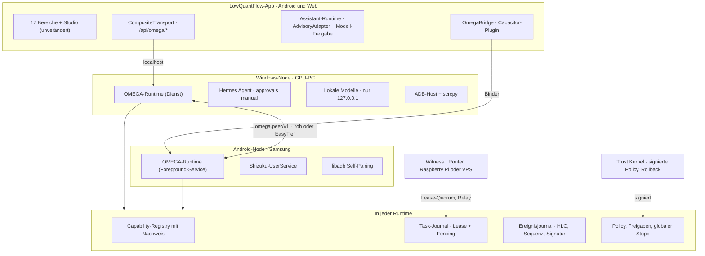
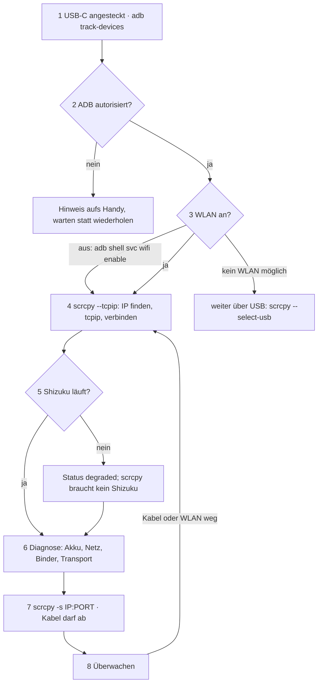

# 31 · Analyse und OMEGA-Plan v1.0

Stand: 3. November 2026. LowQuantFlow bleibt die Oberfläche; OMEGA wird als verteilte Node-Runtime an vier vorhandene Nahtstellen angedockt, statt ein zweites System daneben zu bauen. Grundlage sind die Nachprüfung in [30](30-verifikation-2026-11-03.md) und die PR-Triage in [32](32-pr-triage-2026-11-03.md).

## Kurzfassung

- Der vollständige App-Code (0.5.4) liegt seit 2026-11-04 auf `main` (Merge-Commits `8a3104f` für #8 und `531e4ec` für #9, `app/` byte-gleich mit `16ef6a1`); alle 1.542 Tests und die Gesamtverifikation mit Pin sind grün.
- Frühere Pläne und 16 Analyse-PRs beruhten auf dem Doku-Stand vom 4. Oktober und überschätzten, was neu gebaut werden muss.
- Missionen mit 10 Stufen, Freigabekarten, 4 Agentenprofile, eine Assistant-Runtime mit Evidenzprüfung und ein Pipeline-Runner existieren bereits.
- Die größten Risiken lagen in PR #15 (fernsteuerbare Bridge) und PR #14 (falsch-grüne CI), nicht im App-Code.
- OMEGA erfüllt genau die offenen Teile von INT-01, DEV-01, AUT-01, SIM-01 und OBS-02 aus der [Abnahmematrix](16-acceptance-matrix.md).

## Korrigierte Annahmen

| Frühere Annahme | Belegter Stand |
| --- | --- |
| Repo enthält nur Doku, 859 Dateien extern | Code auf PR #8 (1.034 Dateien) und PR #9 (1.134 Dateien); seit 2026-11-04 auf `main` |
| 264 Tests | 1.542 Web-Tests und 71 JVM-Tests, alle grün |
| Projektgedächtnis nur geplant | MEM-01 geprüft (5 Eintragsarten, Herkunft, CAS, Export) |
| Task-Registry und Policy neu bauen | Missionsvertrag mit 10 Stufen und Freigabekarten mit Risiko, Rollback und Ablauf vorhanden |
| Hermes läuft auf beiden Geräten | Offizielles Hermes-Termux-Paket derzeit defekt; Windows nativ unterstützt |
| Leasing verhindert Doppelausführung | Nur mit monoton steigendem Fencing-Token, geprüft per Compare-and-Swap |
| CAS = Content-Addressed Storage | CAS = Compare-and-Swap |
| USB-C schaltet WLAN ein | Apps dürfen WLAN ab Android 10 nicht schalten; ADB-Shell darf es |

## Zielarchitektur



Koordinator ist immer der aktuelle Lease-Inhaber, nie ein fester Chef. Nur der Trust Kernel liegt außerhalb der Selbstentwicklung.

## Andockpunkte im vorhandenen Code

| Nahtstelle | Datei | Erweiterung |
| --- | --- | --- |
| Transport | [`app/src/work-transport.tsx`](../app/src/work-transport.tsx), [`local-adapter.ts`](../app/src/local-adapter.ts) | `CompositeTransport` leitet nur `/api/omega/*` an die Bridge; CSP `connect-src 'none'` bleibt auf Android unverändert |
| Modelle | [`app/src/assistant/runtime.ts`](../app/src/assistant/runtime.ts), [`contracts.ts`](../app/src/assistant/contracts.ts) | Adapter mit `execution` `local`/`remote` nur mit gültiger `omega.model-grant/v1` |
| Freigaben | [`app/upstream/lib/command-contract.ts`](../app/upstream/lib/command-contract.ts) | Freigabekarten bleiben `executed: false`; Ausführung wird als eigener Receipt belegt |
| Gerät | [`CueFilesPlugin.java`](../app/android/app/src/main/java/de/lowgiga/cuecommandmesh/preview/CueFilesPlugin.java) als Muster | Drittes Plugin `OmegaBridge` nach demselben Lebenszyklus-Muster |
| Rechte | [`app/vendor/skill-core/src/host.mjs`](../app/vendor/skill-core/src/host.mjs) | Ablaufende, widerrufbare Handles als Vorbild für Capability-Leases |
| Außenschnittstelle | [`app/upstream/app/mcp/route.ts`](../app/upstream/app/mcp/route.ts) | Vorlage für den MCP-Server der Nodes nach Spezifikation 2026-07-28 |

## Verträge

```json
{
  "schema": "omega.capability/v1",
  "id": "android.screen.mirror",
  "provider": {"kind": "binary", "name": "scrcpy"},
  "node": "n7f3a9c0d1e2b4a56",
  "effect": "read-only",
  "requires": ["android.adb.authorized"],
  "state": "available",
  "evidence": {"checkId": "probe.scrcpy.version", "status": "passed", "verifiedAt": "2026-11-03T18:40:00Z", "expiresAt": "2026-11-03T18:45:00Z"},
  "fallbacks": ["android.screen.screenshot"]
}
```

- `node` ist selbstzertifizierend: `n` + 16 Hex-Zeichen von SHA-256(öffentlicher Ed25519-Schlüssel); jedes Ereignis wird gegen diese Ableitung geprüft.
- `effect` übernimmt `OperationEffect` aus `assistant/policy.ts`; Wiederholung nur für `pure` und `read-only`. Nachweise gelten höchstens 24 Stunden.
- `omega.task/v1` nutzt die 10 Missionsstufen und die 4 Profile (`zimt`, `manus`, `junior`, `codex`); jeder Schreibzugriff trägt einen Fencing-Token.
- `omega.event/v1` trägt Sequenz je Node, Hybrid Logical Clock, Datenklasse (`public`, `internal`, `personal`, `financial`, `secret`) und Ed25519-Signatur; `secret` verlässt den Node nie.
- `omega.model-grant/v1` begrenzt Tokens, Aufrufe und Kosten pro Tag, Datenklassen und Laufzeit einer Modellbindung; `secret` nie an ein entferntes Modell.
- `omega.owner-approval/v1` ist die Signatur des Eigentümers für genau eine E4-Änderung (Inhalt per SHA-256 gebunden, mit Ablauf).

Alle sieben Verträge liegen als JSON-Schema unter [`omega/contracts/`](../omega/contracts/); Tests prüfen Laufzeit-Objekte und die Beispiele dieses Abschnitts dagegen.

## Plug and Play: USB-C bis scrcpy



Den Startbefehl von Shizuku liest OMEGA zur Laufzeit über `pm path`, weil er sich je Version ändert. Ohne PC (Android 11+) startet der Shizuku-Fork von thedjchi im TCP-Modus nach jedem Neustart selbst, sobald WLAN verfügbar ist.

## Selbstentwicklung

| Stufe | Darf autonom | Bedingung |
| --- | --- | --- |
| E0 Beobachten | Messen und berichten | – |
| E1 Vorschlagen | Varianten im Archiv, Builds in der Sandbox | – |
| E2 Kleine Änderung aktivieren | Konfiguration, Prompts, neue Nur-Lese-Capabilities | Tests grün und unabhängiges Review |
| E3 Code aktivieren | Adapter und Module außerhalb des Trust Kernels | E2 plus Canary und automatische Rücknahme |
| E4 Systemänderung | nichts | Freigabe und Signatur des Eigentümers |

Im Code ([`trust-kernel.mjs`](../omega/runtime/trust-kernel.mjs)) bestimmt die Art der Änderung die Stufe: `proposal` → E1, `config`/`prompt`/`capability-read-only` → E2, `adapter`/`module` → E3, `trust-kernel`/`policy` → E4. Fehlende Nachweise führen zur Ablehnung, eine Stufe über der gewährten zur Freigabeanfrage. E4 ist als Autonomiestufe nicht setzbar.

Das Muster folgt der [Darwin Gödel Machine](https://sakana.ai/dgm/): Archiv statt einzelner Bestlösung, empirische Prüfung, Sandbox und menschliche Aufsicht. Das vorhandene Quality-Gate mit extern gepinntem Vertrags-Hash ist bereits ein Trust-Kernel-Baustein.

## Roadmap und Gates

| Phase | Inhalt | Gate |
| --- | --- | --- |
| P0 | Aufräumen und absichern: PRs triagieren, Lint stabilisieren | Keine roten Befunde aus offenen PRs |
| P1 | Quellbasis und CI: #8/#9 nach `main`, neue CI | CI grün auf `main` mit Pin, Node 22.18.0 und 24, Android-Tests |
| P2 | Release und Gerät | REL-03, REL-04 und QA-01 auf echtem Gerät belegt |
| P3 | Windows-Node und Plug and Play | Kette 8 von 8 Schritten auf dem Gerät, alle Ausweichpfade ausgelöst |
| P4 | Android-Node und Bridge | Task wechselt den Node und läuft ohne Doppelausführung weiter |
| P5 | Agenten und Modelle | DEV-01 mit echtem Modell innerhalb der Budgets |
| P6 | Selbstentwicklung | Eingebauter Fehler autonom erkannt, behoben, geprüft, Rollback belegt |

## Neue Anforderungs-IDs

OMG-01 Node-Identität und Kopplung · OMG-02 Capability-Registry mit Nachweis · OMG-03 Task-Lease mit Fencing · OMG-04 signiertes Ereignisjournal · OMG-05 Plug-and-Play-Kette · OMG-06 Evolutionsschleife mit Trust Kernel · OMG-07 Policy, Budgets und globaler Stopp · OMG-08 Observability über OpenTelemetry · OMG-09 Tasker-Brücke ([34](34-tasker-bruecke.md)). Sie stehen als eigener Block in derselben [Abnahmematrix](16-acceptance-matrix.md#omega-erweiterung-omg-01-bis-omg-09) und folgen denselben Statusregeln; die 27 App-IDs bleiben unverändert.

## Umsetzungsstand

Stand 2026-11-04: P1 teilweise erreicht – #8 und #9 sind per Merge-Commit auf `main`; die neue CI liegt in #30 und kann erst laufen, wenn GitHub Actions im Repository freigeschaltet ist. Die Kernbausteine für OMG-01 bis OMG-04, OMG-07 und OMG-09 sind in [`omega/`](../omega/README.md) umgesetzt und mit 79 Tests geprüft, darunter Drift-Tests gegen `app/` und ein Java-Interop-Test. OMG-05 und OMG-06 sind vorbereitet, OMG-08 ist offen. Geräte- und Windows-Nachweise sowie die CI auf GitHub fehlen noch. Details, Befunde und Behebungen: [35](35-omega-runtime-stand.md).

## Ergänzender Workstream

PR #29 beschreibt „OMEGA Technical Intelligence“: einen Problemlöser für Befehle, Skripte und Repositories mit derselben Trennung von Analyse, Vorschlag und isolierter Ausführung. Seine Analyseadapter (ShellCheck, PSScriptAnalyzer) sind in OMEGA Capabilities mit Nachweis; die Werkzeuge wurden für [32](32-pr-triage-2026-11-03.md) bereits real eingesetzt.

## Quellen

[Hermes Agent Doku](https://hermes-agent.nousresearch.com/docs/getting-started/installation/) · [MCP-Changelog 2026-07-28](https://modelcontextprotocol.io/specification/2026-07-28/changelog) · [scrcpy: Verbindung](https://github.com/Genymobile/scrcpy/blob/master/doc/connection.md) · [Shizuku-Fork thedjchi](https://github.com/thedjchi/Shizuku/wiki/Features) · [libadb-android](https://github.com/MuntashirAkon/libadb-android) · [Open-AutoGLM](https://github.com/zai-org/Open-AutoGLM) · [EasyTier](https://github.com/EasyTier/EasyTier) · [Headscale](https://github.com/juanfont/headscale) · [iroh](https://docs.iroh.computer/what-is-iroh) · [A2A 1.0](https://www.linuxfoundation.org/press/a2a-protocol-surpasses-150-organizations-lands-in-major-cloud-platforms-and-sees-enterprise-production-use-in-first-year)
